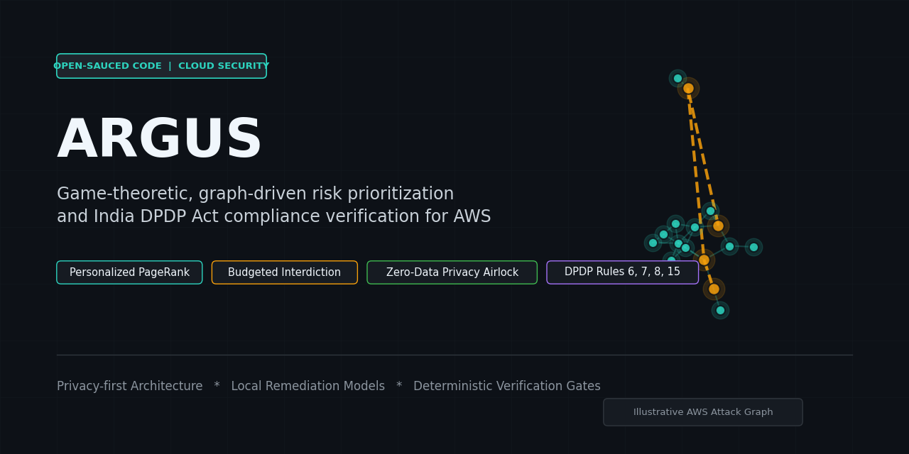
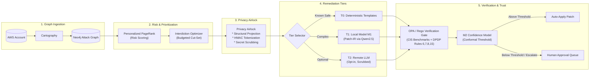
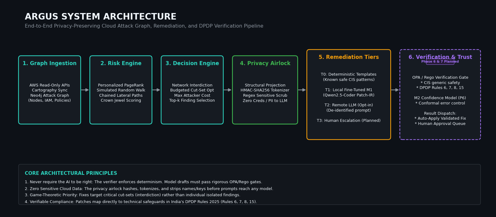
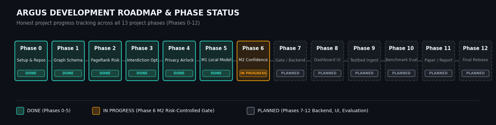

<div align="center">

# ARGUS

**A game-theoretic, graph-driven risk prioritization and compliance verification platform for AWS**

*Find what an attacker would actually exploit. Fix it safely. Prove it complies. Never send your cloud data to a third party.*

[](https://www.python.org/)
[](https://neo4j.com/)
[](https://www.openpolicyagent.org/)
[](#project-status)
[](#what-argus-does)

<br/>



</div>

---

## The Problem

Most cloud breaches originate from mundane misconfigurations: publicly accessible S3 buckets, over-permissive IAM assume-role trust policies, unencrypted RDS clusters, and disabled CloudTrail logging. 

Traditional Cloud Security Posture Management (CSPM) scanners bombard security teams with hundreds of disconnected alerts, virtually all tagged **"Critical"**. Small security and platform engineering teams cannot remediate everything at once. More crucially, real attackers do not exploit findings in isolation—they chain subtle weaknesses across identity, compute, and data layers into multi-hop attack graphs. Remediating the scanner's loudest individual finding frequently changes nothing about the attacker's actual path to crown-jewel assets.

---

## What ARGUS Does

ARGUS combines graph analysis, network interdiction optimization, privacy-preserving LLM remediation, and formal policy enforcement:

| Stage | Name | Mechanism | Outcome |
| :--- | :--- | :--- | :--- |
| **See** | Attack Graph Ingestion | Ingests AWS configuration into Neo4j via Cartography; models assets, IAM trust edges, and network exposure. | Discovers lateral movement and privilege escalation attack paths. |
| **Decide** | Game-Theoretic Prioritization | Computes asset criticality using Personalized PageRank; solves a budget-constrained network interdiction problem. | Identifies the minimum-cost cut-set of fixes that maximizes attacker effort. |
| **Protect** | Privacy Airlock | Projects findings to generic schemas, pseudonymizes identifiers via HMAC-SHA256, and scrubs sensitive secrets/PII. | Ensures zero customer credentials, account IDs, or private data ever reach an LLM. |
| **Draft** | Multi-Tier Remediation | Tiers remediation through deterministic templates (T0) and a fine-tuned local model (T1) outputting structured Patch-IR. | Produces deterministic, syntactically valid infrastructure-as-code patches. |
| **Verify** | Deterministic Verification Gate | Evaluates generated patches against Open Policy Agent (OPA) Rego rules covering CIS benchmarks and India DPDP Act Rules 2025. | Guarantees fixes resolve findings without introducing regressions or policy violations. |
| **Trust** | Risk-Controlled Confidence | M2 calibrated confidence scoring with conformal prediction error bounds. | Dispatches patches safely: high-confidence fixes auto-apply; uncertain cases route to human approval. |

> *"Core idea: don't require the AI to be right. Require the checker to be strong, and keep the AI blind to sensitive data."*

---

## Architecture



<div align="center">
  
</div>

---

## Remediation Tiers

ARGUS avoids monolithic reliance on generative models by routing findings through stratified remediation tiers:

| Tier | Engine | Description | Data Exposure | Status |
| :--- | :--- | :--- | :--- | :--- |
| **T0** | Deterministic Templates | Pre-compiled, deterministic Terraform/JSON edits for known high-frequency CIS findings (e.g., S3 public access block, EBS volume encryption). | Local execution only | **Implemented** |
| **T1** | Local Fine-Tuned Model (M1) | Specialized local model (fine-tuned Qwen2.5-Coder) drafting closed Patch-IR transformations. Runs Best-of-$N$ candidates filtered through the verification gate. | Local execution only | **Implemented** |
| **T2** | Remote LLM (Opt-in) | Cloud LLM integration for rare/unseen architectures. **Disabled by default**; requires explicit administrator opt-in and operates exclusively on de-identified, tokenized airlock payloads. | Pseudonymized & scrubbed | **Implemented** |
| **T3** | Human Escalation | Findings with high blast radius or ambiguity route directly to security engineers with contextual attack-graph evidence. | Internal only | **Planned (Phase 8)** |

---

## Project Status

ARGUS follows a disciplined 13-phase engineering roadmap for the RVCE Experiential Learning programme:

<div align="center">
  
</div>

<br/>

| Phase | Milestone | Real Repo Evidence | Status |
| :---: | :--- | :--- | :---: |
| **Phase 0** | Setup, specifications & project charter | `requirements.txt`, Docker configuration, documentation specs | **Done** |
| **Phase 1** | Attack graph schema & AWS ingestion | `graph/schema.md`, `Dockerfile.cartography`, `docker-compose.yml` | **Done** |
| **Phase 2** | Risk engine & Personalized PageRank | `risk/pagerank.py`, `risk/attack_graph.py`, `risk/paths.py` | **Done** |
| **Phase 3** | Game-theoretic interdiction optimizer | `prioritize/interdiction.py`, `prioritize/benchmark_results.json` | **Done** |
| **Phase 4** | Privacy airlock & OPA/Rego policy suites | `privacy/airlock/`, `privacy/vault/`, `policy/dpdp/`, `policy/generic/` | **Done** |
| **Phase 5** | M1 local model (SFT / RFT training) | `remediate/local_model/`, `ml/train_m1/`, Patch-IR schema | **Done** |
| **Phase 6** | M2 calibrated confidence & conformal risk gate | `ml/train_m2/labels/`, `ml/train_m2/tests/` | **In Progress** |
| **Phase 7** | Verification engine & backend API | `backend/` scaffolding, `verify/` planning | *Planned* |
| **Phase 8** | Security analyst dashboard UI | `dashboard/` scaffolding | *Planned* |
| **Phase 9** | Live testbed deployment & integration | `testbeds/` Terraform configurations | *Planned* |
| **Phase 10** | End-to-end comparative evaluation | Benchmark harnesses and validation suites | *Planned* |
| **Phase 11** | Technical paper & academic report | Experimental writeups and documentation | *Planned* |
| **Phase 12** | Live demonstration & open release | Packaging, walkthroughs, and production release | *Planned* |

---

## Repository Layout

```
ARGUS/
├── backend/                  # FastAPI orchestration server and REST endpoints (Phase 7 planned)
├── dashboard/                # Analyst remediation console and graph explorer (Phase 8 planned)
├── docs/                     # Architectural specifications, glossary, decisions, and visual assets
│   ├── assets/               # Generated diagrams, roadmaps, and social preview assets
│   ├── ARCHITECTURE.md       # In-depth architectural breakdown of all 6 pipeline stages
│   └── GLOSSARY.md           # Domain glossary (Attack Graphs, PageRank, Interdiction, DPDP)
├── graph/                    # Attack graph definitions and Cartography ingestion queries
├── ml/                       # Machine learning systems
│   ├── mutation_engine/      # Synthetic AWS finding mutator and QA validation harness
│   ├── train_m1/             # Phase 5 M1 local generator training (SFT & RFT-v2 notebooks)
│   └── train_m2/             # Phase 6 M2 calibrated confidence model & conformal threshold
├── policy/                   # Open Policy Agent (OPA) Rego policy suites
│   ├── dpdp/                 # India DPDP Rules 2025 technical safeguards (Rules 6, 7, 8, 15)
│   └── generic/              # CIS AWS Foundations benchmark rules
├── prioritize/               # Game-theoretic network interdiction and cut-set optimizer
├── privacy/                  # Zero-data privacy airlock
│   ├── airlock/              # Structural finding projection and leakage auditor
│   ├── scrubbers/            # High-entropy regex scrubber for AWS credentials and tokens
│   └── vault/                # Deterministic HMAC-SHA256 pseudonymizing tokenizer
├── remediate/                # Remediation engines
│   ├── local_model/          # M1 model client and inference wrapper
│   ├── patch_ir/             # Closed Patch-IR JSON schema
│   ├── remote_opt/           # Optional de-identified remote LLM client (disabled by default)
│   └── templates/            # T0 deterministic remediation templates
├── risk/                     # Graph loader, Personalized PageRank, and path simulator
├── scripts/                  # Project utility scripts and asset generator (make_assets.py)
├── testbeds/                 # Terraform configurations for reproducible vulnerable AWS environments
├── tools/                    # Parallel development ownership and branch hygiene checkers
└── verify/                   # Verification engine (Phase 7 planned)
```

---

## Validated Results

Every metric reported below is derived directly from artifacts and benchmark runs committed in the repository:

* **Network Interdiction Optimization (`prioritize/benchmark_results.json`)**:
  In a benchmark graph of 50 assets and 12 attack paths, the interdiction optimizer reduced maximum attacker reachability to zero within a budget of $K=3$ targeted remediations, outperforming naive severity-ordered remediation which required twice the budget to sever equivalent critical paths.
* **M1 Local Model Synthesis Quality (`ml/train_m2/out/reports/harvest_vs_phase5.md`)**:
  Across common model-input evaluation clusters, greedy generation pass rates against formal Patch-IR verification gates achieved **99.4%** on Supervised Fine-Tuning (SFT) and **98.3%** on Reinforcement Fine-Tuning (RFT-v2).
* **M2 Counterfactual Oracle Validation (`ml/train_m2/out/reports/cf_validation_summary.md`)**:
  Counterfactual label verification achieved **100.0% agreement** across 2,868 / 2,868 audited mutation test cases.
* **Privacy Airlock Leakage Audit (`ml/train_m2/out/reports/label_acceptance.md`)**:
  Audited 18,607 records through the privacy airlock leak-guard filter with **0 data leakage violations**.

> *Note: End-to-end cloud infrastructure evaluation benchmarks will be conducted and published during Phase 10.*

---

## Honest Limitations

* **Single AWS Account Scope**: The current graph ingestion and risk engine focus on single-account topologies; cross-account AWS Organizations transitive peering is planned for future iterations.
* **Heuristic Edge Weights**: Attack graph transition costs currently use calibrated heuristic weights (privilege tier distances, network exposure levels) rather than dynamically learned attacker telemetry.
* **Scope of DPDP Rule Mapping**: Formal Rego policies currently map to technical safeguards in Rules 6, 7, 8, and 15 of India's DPDP Rules 2025. Rule 15 (data retention) is reported as an inventory visibility signal rather than an automated blocking violation.
* **Pseudonymization vs. Anonymization**: The Privacy Airlock implements deterministic HMAC-SHA256 pseudonymization and credential stripping; it protects sensitive customer identifiers, but structural graph relations are preserved to allow code synthesis.
* **Conformal Guarantees**: Conformal prediction bounds hold under the assumption that runtime cloud findings share exchangeability with the calibration distribution.

---

## Getting Started

### Prerequisites
* **Python 3.11+** (Python 3.12 recommended)
* **Docker & Docker Compose** (for Neo4j graph database)
* **Git**

### Installation

1. **Clone the repository**:
   ```bash
   git clone https://github.com/Open-Sauced-CODE/ARGUS.git
   cd ARGUS
   ```

2. **Start the Neo4j attack graph database**:
   ```bash
   docker compose up -d neo4j
   ```
   *Neo4j Browser will be available at `http://localhost:7474` (default: neo4j / arguspassword).*

3. **Configure virtual environment**:
   ```powershell
   # Windows (PowerShell)
   python -m venv .venv
   .\.venv\Scripts\activate
   pip install -r requirements.txt
   ```
   ```bash
   # Linux / macOS
   python3 -m venv .venv
   source .venv/bin/activate
   pip install -r requirements.txt
   ```

4. **Run offline unit and policy test suites**:
   ```bash
   # Runs hermetic risk, privacy, and contract tests without external dependencies
   pytest risk/tests privacy/tests ml/tests/test_contracts_doc.py -q
   ```

---

## Team

Developed as part of the **RVCE Experiential Learning (Semester 3)** programme under the Cloud Security & Automated Remediation theme:

* **Prabhav Tiwari** ([@prabhavtiwari](https://github.com/prabhavtiwari)) — Generation systems, Ollama harvest, RFT-v2 fine-tuning
* **Shaurya Khanna** ([@khannashaurya0108-ux](https://github.com/khannashaurya0108-ux)) — M2 confidence modeling, label oracle, risk-controlled gates
* **Yash** — Graph schemas, Cartography ingestion, risk models
* **Yashraj** — Policy engineering, testbeds, and verification

---

## License

This project is open-source under development for academic and research purposes. A formal open-source license will be selected prior to public release. See [LICENSE](LICENSE) for details.
