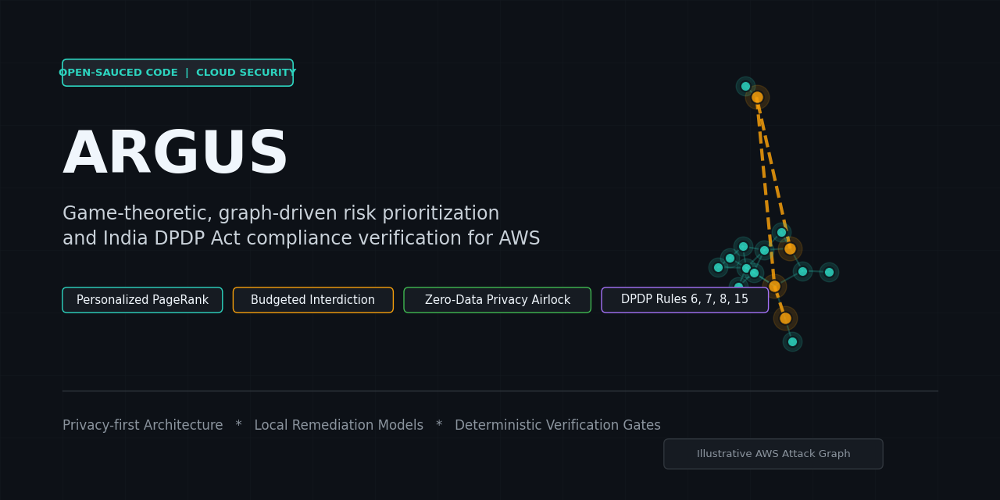
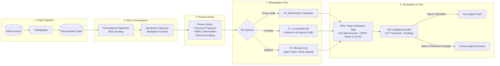
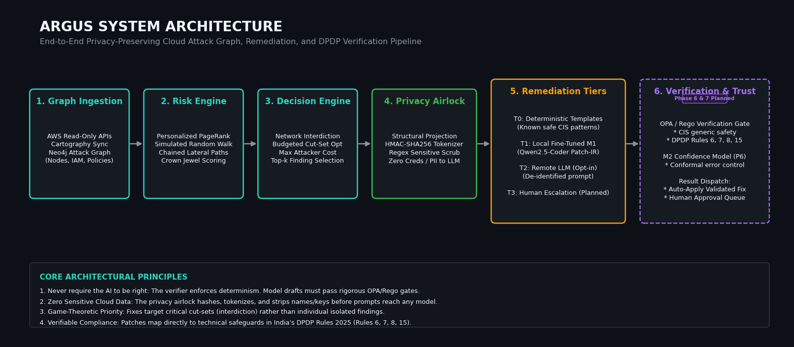

<div align="center">

# ARGUS

**A game-theoretic, graph-driven risk prioritization and compliance verification platform for AWS**

*Find what an attacker would actually exploit. Fix it safely. Prove it complies. Never send your cloud data to a third party.*

[](https://www.python.org/)
[](https://neo4j.com/)
[](https://www.openpolicyagent.org/)
[](#status)
[](#what-argus-does)

<br/>



</div>

Built as an RVCE experiential-learning capstone and entered in the Campus to Cloud Hackathon (Techfest, IIT Bombay and AWS).

| Resource | Link |
| :--- | :--- |
| Live demo | [http://13.201.224.53/](http://13.201.224.53/) <!-- TODO(owner): confirm live demo URL stays up through Demo Day --> |
| Demo video (under 3 min) | _added at submission_ <!-- TODO(owner): add Demo Video URL (script at docs/hackathon/Demo_Video_Script.md) --> |
| Idea brief | [docs/hackathon/Idea_Brief.md](docs/hackathon/Idea_Brief.md) |
| Build summary | [docs/hackathon/Build_Summary.md](docs/hackathon/Build_Summary.md) |
| Code repository | [https://github.com/Open-Sauced-CODE/ARGUS](https://github.com/Open-Sauced-CODE/ARGUS) |

---

## The Problem

Cloud breaches commonly stem from mundane misconfigurations: public S3 buckets, wildcard IAM policies, unencrypted RDS databases, and disabled CloudTrail logging. Conventional scanners rank findings individually and leave small teams with hundreds of "Critical" alerts, ignoring how attackers chain identity, network, and storage flaws into multi-hop compromise paths. Meanwhile, pasting infrastructure configs or logs into hosted AI APIs exposes sensitive topology and customer metadata.

### Why It Matters in India

India's Digital Personal Data Protection (DPDP) Rules, 2025 were notified on 13 November 2025 and take full effect in mid-May 2027 ([v3 design doc](docs/ARGUS_v3_Tiered_Privacy_First_Remediation.md), [DPDP mapping table](docs/dpdp-mapping-table.md)). Small startup, university, and public-portal engineering teams rarely have dedicated SecOps staff, yet must demonstrate technical safeguards under **Rule 6** (encryption, access control, versioning, logging), **Rule 7** (72-hour breach detection readiness), **Rule 8** (retention and erasure lifecycles), and **Rule 15** (cross-border transfer visibility).

---

## Who It Helps

| Persona | Core Need | Dashboard Feature Used |
| :--- | :--- | :--- |
| **Founder-Engineer** | Fix the few misconfigurations that actually stop breaches without breaking production | Interdiction budget cut-set (`/plan`) and verified patch diff export (`/approvals`) |
| **SOC Analyst** | Trace multi-hop IAM and network paths instead of triaging flat alert lists | Interactive attack graph explorer (`/map`) and candidate verification pipeline (`/pipeline`) |
| **Compliance Officer** | Track DPDP Rules 2025 readiness and confirm what data any model saw | DPDP readiness scorecard (`/compliance`) and Privacy Receipt viewer (`/proof`) |

---

## What ARGUS Does

| Stage | Name | Mechanism | Outcome |
| :--- | :--- | :--- | :--- |
| **See** | Attack Graph Ingestion | Ingests AWS configuration into Neo4j (or in-memory NetworkX for local scans); models assets, IAM trust edges, and ingress exposure. | Discovers lateral movement and privilege escalation attack paths. |
| **Decide** | Game-Theoretic Prioritization | Computes asset criticality using Personalized PageRank; solves a budget-constrained network interdiction MILP. | Identifies the minimum-cost cut-set of fixes that maximizes attacker path cost. |
| **Protect** | Privacy Airlock | Projects only rule-declared fields, tokenizes identifiers with deterministic mappings, and scrubs secrets/PII via regex and Presidio. | Ensures zero customer credentials, account IDs, or private data reach an LLM. |
| **Draft** | Multi-Tier Remediation | Routes findings through deterministic templates (T0) and a fine-tuned local `unsloth/Qwen3.5-4B` model (T1) outputting closed JSON Patch-IR. | Produces deterministic, schema-constrained remediation edits locally. |
| **Verify** | Deterministic Verification Gate | Evaluates candidate patches against Open Policy Agent (OPA) Rego rules covering CIS benchmarks and India DPDP Rules 2025. | Rejects invalid patches, deletions, or privilege widenings before application. |
| **Trust** | Risk-Controlled Confidence | Calibrated M2 confidence scoring (`ml/train_m2/`) paired with Learn-Then-Test / conformal risk control (calibration in progress). | Keeps autonomy OFF until certified; routes uncertified or uncertain patches to human approval. |

> *"Core idea: don't require the AI to be right. Require the checker to be strong, and keep the AI blind to sensitive data."*

---

## Architecture



<div align="center">
  
</div>

---

## See It Work

A 3-minute walkthrough from vulnerable infrastructure to verified fix:

1. **Vulnerable AWS testbed** (`testbeds/`): Scan the local DPDP/CIS Terraform workspace (`testbeds/sample_dpdp_infra/main.tf`) or read-only AWS control-plane metadata via `local_engine/` (live in local mode; simulated showcase scenario in cloud mode).
2. **Attack graph** (`graph/`, `risk/`): Build the asset graph and run Personalized PageRank (`risk/pagerank.py`) to expose multi-hop IAM and network paths to PII stores.
3. **Ranked fixes** (`prioritize/`): Solve the MILP network interdiction problem (`prioritize/interdiction.py`) to pick the highest-impact $K$ fixes within budget.
4. **Privacy airlock** (`privacy/`): Project rule-declared fields (`privacy/airlock/`), tokenize real identifiers (`privacy/vault/`), scrub secrets/Aadhaar/PAN (`privacy/scrubbers/`), and emit a leak-checked Privacy Receipt.
5. **Verified patch** (`remediate/`, `policy/`, `ml/`): Draft Patch-IR via T0 templates or local `unsloth/Qwen3.5-4B` (M1) and verify against OPA Rego rules (`policy/dpdp/`, `policy/generic/`) and intent checks.
6. **Approve or auto-apply** (`ml/train_m2/`, `backend/`, `dashboard/`): Inspect confidence scores, diffs, and receipts in the React UI (`dashboard/` uses mock fallback data under `dashboard/src/mock/` in standalone/cloud showcase mode, and connects to live local scans when launched via `deploy_dashboard.py --local`; see [docs/hackathon/Build_Summary.md](docs/hackathon/Build_Summary.md)).

---

## Built on AWS

| Category | AWS Service | What We Use It For | Why |
| :--- | :--- | :--- | :--- |
| **Analysed** | **IAM** | Inspect users, roles, attached policies, trust policies, and access keys (`testbeds/`, `graph/schema.md`). | Detects privilege-escalation chains and wildcard permissions without reading data planes. |
| **Analysed** | **Amazon S3** | Audit bucket public access blocks, encryption, versioning, logging, and lifecycle rules (`testbeds/sample_dpdp_infra/main.tf`). | Primary storage surface for DPDP Rules 6 and 8 compliance checks. |
| **Analysed** | **Amazon EC2 & VPC** | Audit security group ingress CIDRs, VPCs, subnets, NACLs, and route tables (`graph/schema.md`). | Identifies internet-exposed entry points feeding lateral movement. |
| **Analysed** | **Amazon RDS** | Check `storage_encrypted` posture on database instances (`testbeds/sample_dpdp_infra/main.tf`). | Protects personal-data relational stores under DPDP Rule 6a. |
| **Analysed** | **AWS CloudTrail** | Check `enable_logging` state (`testbeds/sample_dpdp_infra/main.tf`, `docs/dpdp-mapping-table.md`). | Signals readiness for DPDP Rule 7 breach detection and investigation. |
| **Demo Hosting** | _added at submission_ | Public web showcase host <!-- TODO(owner): confirm exact AWS hosting services for submission (e.g., EC2 t3.micro ap-south-1 in docs/hackathon/Build_Summary.md and packaging/deploy_ec2.ps1, or S3 + CloudFront) --> | Keeps sensitive local scanning on-device while serving the live demo portal on AWS. |

---

## Remediation Tiers

| Tier | Engine | Description | Data Exposure | Status |
| :--- | :--- | :--- | :--- | :--- |
| **T0** | Deterministic Templates | Rule-keyed Patch-IR edits for 7 single-attribute S3 CIS and DPDP rules (`remediate/templates/__init__.py`). | Local execution only | **Implemented** |
| **T1** | Local Model (M1) | `unsloth/Qwen3.5-4B` fine-tuned for schema-constrained Patch-IR via Ollama (`remediate/local_model/__init__.py`, `ml/train_m1/`). | Local execution only | **Trained, runtime wiring in progress** |
| **T2** | Remote LLM (Opt-in) | Optional scrubbed fallback (`remediate/remote_opt/` placeholder only; off by default). | Pseudonymized & scrubbed | **Stub** |
| **T3** | Human Escalation | Routes `escalate`-only, low-confidence, or uncertified patches (`ml/train_m2/decide.py`) to `/approvals`. | Internal only | **Planned** |

---

## Status

* **Works today**: Neo4j / NetworkX attack graph ingestion (`graph/`, `local_engine/`), Personalized PageRank risk engine (`risk/`), PuLP/SciPy network interdiction optimizer (`prioritize/`), Privacy Airlock (`privacy/`), OPA Rego policies for CIS and DPDP (`policy/`), T0 templates (`remediate/templates/`), fine-tuned M1 `unsloth/Qwen3.5-4B` training pipeline (`ml/train_m1/`), React showcase dashboard (`dashboard/`), and dual-mode Python server (`backend/api_server.py`, `deploy_dashboard.py`).
* **In progress**: M2 calibrated confidence evaluation (`ml/train_m2/`, [docs/PHASE6_RESULTS.md](docs/PHASE6_RESULTS.md) reports certification as `PENDING` until full 5-fold cross-fit regeneration and one-shot held-out evaluation complete), runtime M1/M2 integration, and live dashboard API wiring beyond mock fallbacks.
* **Next**: Complete clean cross-fit regeneration and certify `tau_star.json`, finish standalone `verify/` orchestration (`verify/README.md`), and complete end-to-end live testbed remediation.

---

## Results

Figures measured on inputs seen during model training are **in-sample**, not generalization estimates.

<details>
<summary>Verified metrics from committed repository reports and benchmarks (click to expand)</summary>

| Area | Metric & Source | Honest Caveat |
| :--- | :--- | :--- |
| **Network Interdiction** | Outperformed naive and Stackelberg baselines in **43/50** (budget 2), **49/50** (budget 4), and **49/50** (budget 6) random graphs; mean solve time **35.3 ms**, scale probe 58 findings ([prioritize/benchmark_results.json](prioritize/benchmark_results.json)). | Evaluated on 50 synthetic random graph instances (`brute_force_checks = 0` in artifact), not production AWS accounts. |
| **M1 Patch Synthesis (In-Sample Common Keys)** | On **181** common model-input keys, greedy gate pass rates were **99.4% (180/181)** for SFT and **98.3% (178/181)** for RFT vs **11.0% (20/181)** zero-shot ([ml/train_m2/out/reports/harvest_vs_phase5.md](ml/train_m2/out/reports/harvest_vs_phase5.md)). | Common keys overlap training inputs (**in-sample**); rates across different input sets are not comparable. |
| **M1 Cross-Fit OOF (Partial)** | Across validated folds 0, 1, and 3, **105/105** clean unseen clusters passed the gate and **103/105** were minimal-correct (`k=2`, `n=120` vs `cp_min_n=124` at $\alpha=0.05, \delta=0.05$; **22/105** near-duplicates flagged) ([oof_greedy_labels.md](ml/train_m2/out/reports/oof_greedy_labels.md), [near_dup_oof.md](ml/train_m2/out/reports/near_dup_oof.md)). | Folds 2 and 4 were marked `INVALID` (missing stop token); certification remains `PENDING` until clean regeneration and held-out evaluation. |
| **Counterfactual Oracle** | **100.0% agreement (2,868 / 2,868)** across all 14 rule families ([cf_validation_summary.md](ml/train_m2/out/reports/cf_validation_summary.md)). | BFS (`max_edits=3`) is permissive on compound multi-field S3 rules (`dpdp.rule6_public_exposure`, `cis.s3_public_access_block`). |
| **M2 Label Leak-Guard Audit** | **18,607** label rows audited with **0** violations ([leak_audit.md](ml/train_m2/out/reports/leak_audit.md)); `500/500` feature-parity checks passed ([docs/PHASE6_RESULTS.md](docs/PHASE6_RESULTS.md)). | Audits M2 label partitioning via `leakguard`, not runtime Privacy Airlock egress; held-out test sets remain sealed (`PENDING`). |

</details>

---

## Honest Limitations

* **Confidence threshold not yet certified**: `ml/train_m2/out/tau_star.json` currently has `certified: false` ([docs/PHASE6_RESULTS.md](docs/PHASE6_RESULTS.md)), so autonomous apply stays **OFF** and candidates route to human review (`decide.py`).
* **Single AWS account scope**: Graph ingestion models single-account topologies; cross-account AWS Organizations peering is outside current scope.
* **Heuristic edge weights**: Attack graph transition probabilities use calibrated heuristic weights rather than learned runtime attacker telemetry.
* **Scope of DPDP Rules mapping**: Rego policies check technical proxies for Rules 6, 7, and 8 (retention/erasure). **Rule 15 (cross-border transfer)** is a permissive negative-list check surfaced as an inventory visibility flag rather than an automated blocking violation ([docs/dpdp-mapping-table.md](docs/dpdp-mapping-table.md)).
* **Pseudonymization preserves structure**: The Privacy Airlock strips secrets and replaces identifiers with deterministic tokens, while preserving structural resource relations needed for synthesis.
* **Exchangeability assumption**: Conformal / LTT risk bounds assume deployment findings share exchangeability with the calibration distribution.

---

<details>
<summary>Repository layout (click to expand)</summary>

```text
ARGUS/
├── backend/              # Dual-mode HTTP server (showcase & local agent API)
├── dashboard/            # React + TypeScript UI (implemented with mock fallback data)
├── docs/                 # Architecture specs, glossary, DPDP mapping, hackathon briefs
├── graph/                # Attack graph schema and Cartography ingestion docs (implemented)
├── local_engine/         # Local Terraform/AWS scanners, Ollama GGUF & OPA helpers (implemented)
├── ml/
│   ├── mutation_engine/  # Synthetic AWS finding mutator and QA gate harness (implemented)
│   ├── train_m1/         # M1 Qwen3.5-4B SFT/RFT notebooks & OOF scorer (implemented)
│   └── train_m2/         # M2 confidence model, labels, features & LTT calibration (in progress)
├── packaging/            # Windows desktop installer build & EC2 deploy scripts (implemented)
├── policy/               # OPA Rego suites: CIS AWS (generic/) and DPDP Rules (dpdp/) (implemented)
├── prioritize/           # Network interdiction MILP cut-set optimizer (implemented)
├── privacy/              # Airlock projection, Fernet vault, Presidio/regex scrubbers (implemented)
├── remediate/
│   ├── local_model/      # T1 local Ollama client wrapper (implemented)
│   ├── patch_ir/         # Closed Patch-IR JSON schema (implemented)
│   ├── remote_opt/       # T2 remote LLM placeholder (stub)
│   └── templates/        # T0 deterministic templates (implemented)
├── risk/                 # Neo4j/graph loader and Personalized PageRank scorer (implemented)
├── testbeds/             # Sample DPDP Terraform workspace and AWS test templates (implemented)
├── tools/                # Parallel development ownership and frozen-contract checks (implemented)
└── verify/               # Standalone verification runner placeholder (stub)
```

</details>

---

## Getting Started

**Prerequisites**: Python 3.11+ (3.12 recommended), Docker & Docker Compose, [OPA CLI](https://www.openpolicyagent.org/) (`opa` on `PATH`, required for policy tests), Node.js/npm (for dashboard), Git.

```powershell
# 1. Clone and start Neo4j
git clone https://github.com/Open-Sauced-CODE/ARGUS.git
cd ARGUS
docker compose up -d neo4j

# 2. Python environment & offline hermetic tests (matching .github/workflows/tests.yml)
python -m venv .venv
.\.venv\Scripts\activate          # Linux/macOS: source .venv/bin/activate
pip install -r requirements.txt   # Or requirements-ci.txt for offline tests
pytest risk/tests privacy/tests ml/tests/test_contracts_doc.py -q
```

**Run the dashboard locally** (`dashboard/package.json` scripts: `dev`, `build`, `preview`, `typecheck`; uses `dashboard/src/mock/` data unless paired with `python deploy_dashboard.py --local`):

```powershell
cd dashboard
npm install
npm run dev
```

---

## Team

Built by undergraduate engineering students at **R. V. College of Engineering (RVCE)** as part of the Experiential Learning capstone programme:

* **Prabhav Tiwari** ([@prabhavtiwari](https://github.com/prabhavtiwari)) - Generation pipeline, Ollama harvest, M1 fine-tuning
* **Shaurya Khanna** ([@khannashaurya0108-ux](https://github.com/khannashaurya0108-ux)) - M2 confidence modeling, label oracle, risk-controlled threshold
* **Yash** - Graph schemas, Cartography ingestion, risk scoring
* **Yashraj** - Policy engineering, testbeds, verification

---

## License

License: to be added by the maintainers.
