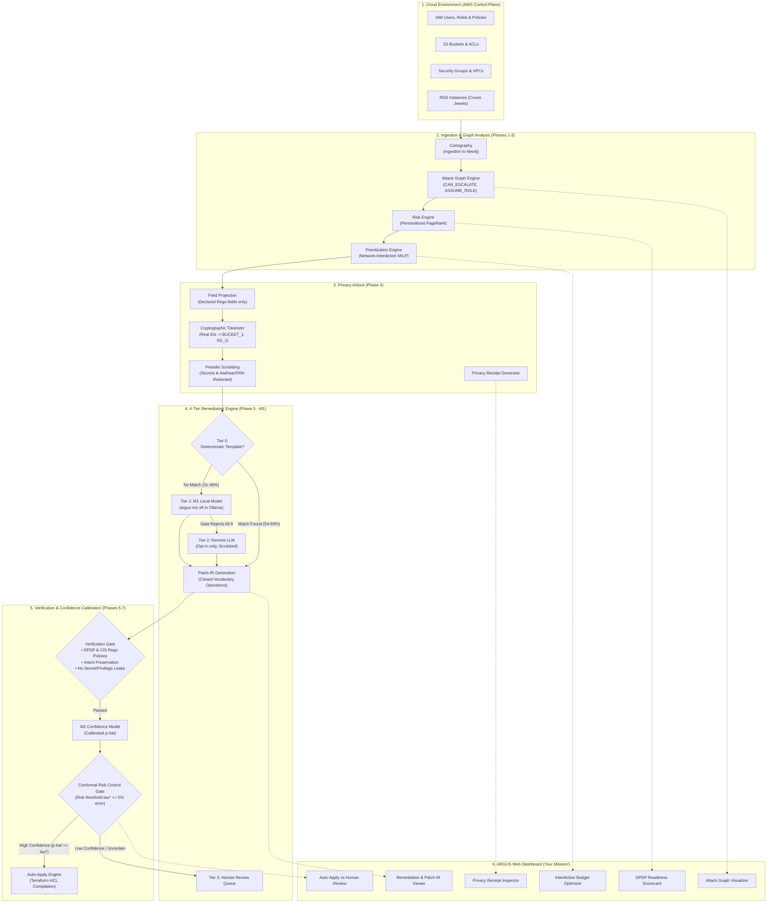

# ARGUS System Context & Dashboard Implementation Guide
### End-to-End System Architecture, Phases 1–6 Accomplishments, and Zero-Conflict Dashboard Blueprint
**Target Audience:** Frontend / Dashboard Engineer (Solo Branch: `dashboard/`)  
**Document Version:** 1.0.0 (Phase 6 Milestone)  
**Date:** October 26, 2026  
**Authors:** ARGUS Core Engineering Team  

---

## 1. Welcome & Executive Orientation

Welcome! This document provides everything you need to design and implement the **ARGUS Dashboard** completely independently, without stepping on backend/ML code, and with **zero merge conflicts**.

ARGUS is a **privacy-first, verifier-guided cloud security remediation platform** mapped specifically to **India’s Digital Personal Data Protection (DPDP) Act, 2025/2027** and **CIS Benchmarks**.

Instead of blindly sending sensitive cloud configurations to expensive or rate-limited third-party LLMs (like OpenAI or Anthropic), ARGUS uses a **local, 4-tier remediation ladder**:
1. **Graph-Theoretic Prioritization:** Analyzes AWS IAM and cloud asset relationships as an attack graph, identifying the most dangerous attack paths to "crown jewel" databases using Personalized PageRank and Network-Interdiction MILP.
2. **Privacy Airlock:** Projects out irrelevant attributes, scrubs all secrets and personal data (PAN, Aadhaar, names) via Presidio, and swaps real resource IDs with virtual cryptographic tokens (`BUCKET_1`, `SG_1`).
3. **Local Fine-Tuned Model (M1):** Generates structured intermediate representation (**Patch-IR**) using an on-device, 4-bit fine-tuned language model (`argus-m1-sft` in Ollama).
4. **Verification Gate & Confidence Calibration (M2):** Validates all patches against policy-as-code (Rego), computes calibrated defect probabilities, and uses statistical **Conformal Risk Control** to safely decide between **Auto-Apply** and **Human Review**.

---

## 2. End-to-End Solution Architecture



---

## 3. Deep Dive into Completed Phases (What Exists Today)

### Phase 1–3: Attack Graph, Risk Scoring & Network Interdiction
* **Cartography + Neo4j (`graph/`):** Automatically ingests AWS IAM users, policies, roles, EC2 instances, S3 buckets, and RDS instances into an attack graph.
* **Risk Engine (`risk/`):** Computes attack probabilities using **Personalized PageRank (PPR)**. It calculates the likelihood of an attacker traversing from an internet-facing entry point (e.g. compromised EC2 or developer access key) to high-value "crown jewels" (e.g. customer data in RDS/S3).
* **Prioritization Engine (`prioritize/`):** Cloud security teams are overwhelmed by thousands of alerts. ARGUS solves this using **Network-Interdiction Mixed-Integer Linear Programming (MILP)**:
  * Given a remediation budget of $K$ fixes (e.g., $K=3$ or $K=5$), it mathematically identifies the optimal subset of fixes that maximizes the attacker's shortest path length to the crown jewels.
  * Replaces ad-hoc triage with a mathematically optimal interdiction frontier.

---

### Phase 4: Privacy Airlock & Cryptographic Token Vault
* **Location:** [`privacy/airlock/`](file:///c:/Users/Prabhav/Downloads/ARGUS/privacy/airlock/), [`privacy/vault/`](file:///c:/Users/Prabhav/Downloads/ARGUS/privacy/vault/), [`privacy/scrubbers/`](file:///c:/Users/Prabhav/Downloads/ARGUS/privacy/scrubbers/)
* **Core Principle:** M1 and remediation generators must operate under a strict **Zero-Data-Plane** guarantee.
* **The 4-Step Pipeline:**
  1. **Projection (`project()`):** Rego rules declare the exact attributes they inspect (e.g. `versioning_status`, `storage_encrypted`). Unrelated attributes are dropped.
  2. **Tokenization (`tokenize()`):** Real account IDs, ARNs, and resource names are substituted with virtual tokens (`BUCKET_1`, `SG_1`, `RESOURCE_1`). Mappings are saved into an encrypted SQLite token vault.
  3. **Scrubbing (`scrub()`):** Runs Microsoft Presidio and regex recognizers to detect and redact credentials, API keys, and Indian PII (Aadhaar numbers, PAN cards, phone numbers).
  4. **Leak-Check (`leak_check()`):** Asserts that zero real vault values or secrets escape into the payload.
* **The Privacy Receipt (`docs/privacy-receipt-schema.md`):** Every remediation event emits a cryptographically verifiable JSON receipt proving what data was masked and that zero raw identifiers left the machine.

---

### Phase 5: M1 Local Remediation Engine (Our Core Achievement)
* **Location:** [`remediate/local_model/`](file:///c:/Users/Prabhav/Downloads/ARGUS/remediate/local_model/), [`remediate/templates/`](file:///c:/Users/Prabhav/Downloads/ARGUS/remediate/templates/), [`ml/train_m1/`](file:///c:/Users/Prabhav/Downloads/ARGUS/ml/train_m1/)
* **Zero-API-Cost Data Engine:** We created a deterministic mutation engine that manufactured **3,309 synthetic, verifiable examples** (2,507 train, 361 val, 261 B1, 180 B2) with ground-truth correctness guaranteed by construction, supplemented by **58 real-world scanned GitHub repositories** (Tier C).
* **Patch-IR (Intermediate Representation):**
  Instead of asking LLMs to hallucinate raw HCL/Terraform files, M1 generates structured, typed JSON with **7 closed-vocabulary operations**:
  * `set_attr` (e.g. set `versioning_status = "Enabled"`)
  * `add_policy_statement`
  * `remove_policy_statement`
  * `restrict_cidr` (e.g. collapse open `0.0.0.0/0` ingress to internal VPC CIDR)
  * `enable_feature`
  * `set_lifecycle_rule`
  * `escalate` (route to human security reviewer)
* **Model Training Ladder:**
  * **Base Model:** Qwen3.5-4B quantized to 4-bit (`Q4_K_M` GGUF, 2.59 GB VRAM).
  * **SFT (Supervised Fine-Tuning):** Trained via Unsloth QLoRA on free T4 GPUs.
  * **RFT (Rejection-Sampling Fine-Tuning):** Aligned with policy-gate feedback.
* **Flawless Safety Record & Verification:**
  * **100.0% Schema Validity** across 2,728 test generations.
  * **0.00% Unsafe Outputs:** 0 dangerous suggestions (no unintended deletes, no security group widening).
  * **89.3% Pass@1 on Real Production Repositories (`C_verifier`):** Outperformed both the zero-shot base model (35.6%) and solved real code without degradation.
  * **Production Model Designation:** SFT (`argus-m1-sft`) is designated as the production model under Rule 5.2 due to **96.7% pass@1** and **99.4% pass@8 diversity**.
* **Frozen Team API:**
  ```python
  from remediate.templates import match
  from remediate.local_model import generate, generate_with_stats

  # Tier 0 instant deterministic repair (0ms latency, 100% pass)
  patch = match(finding)
  if patch is None:
      # Tier 1 on-device local model generation (schema-constrained)
      candidates, stats = generate_with_stats(finding, n=8)
  ```

---

### Phase 6: M2 Confidence Model & Conformal Risk Threshold
* **Location:** [`ml/train_m2/`](file:///c:/Users/Prabhav/Downloads/ARGUS/ml/train_m2/)
* **The Harvest:** We built a resumable, sharded harvest engine (`m2.harvest.v1`) and generated **7,704 candidates with per-token logprobs and top-5 alternatives** across 321 distinct cloud finding inputs.
* **The M2 Confidence Model:**
  * Extracts candidate agreement consensus (`stats["agreement_rate"]`), mean token log-probabilities (`stats["logprob_mean"]`), minimum token confidence, and verification gate outcomes.
  * Trains a lightweight, calibrated classifier that outputs true posterior probability of correctness:
    $$\hat{p} = P(\text{Patch is defect-free} \mid \text{features})$$
* **Conformal Risk Control Gate:**
  * Replaces arbitrary confidence cutoffs with distribution-free statistical risk control (Angelopoulos et al.):
    $$\mathbb{E}[\text{Defect Rate}(\tau^*)] \le 0.05$$
  * Guarantees that at least **95% of auto-applied patches are strictly defect-free**. If $\hat{p} < \tau^*$, the patch automatically routes to the **Human Review Queue** on the dashboard.

---

## 4. Dashboard Blueprint: The 6 Core Views to Build

The dashboard will live entirely inside the [`dashboard/`](file:///c:/Users/Prabhav/Downloads/ARGUS/dashboard/) folder. It should be a modern, responsive single-page application (React + Vite recommended) with a dark-mode first, premium cybersecurity aesthetic.

```text
dashboard/
├── package.json
├── vite.config.ts
├── src/
│   ├── components/
│   │   ├── GraphVisualizer/        <-- View 1: Neo4j Attack Graph (PPR Risk)
│   │   ├── DPDPReadiness/          <-- View 2: Indian DPDP Compliance Scorecard
│   │   ├── InterdictionPanel/      <-- View 3: Budget Optimizer & Pareto Curve
│   │   ├── RemediationViewer/      <-- View 4: Patch-IR & HCL Code Diff Viewer
│   │   ├── AutoApplyGate/          <-- View 5: M2 Confidence & Human Queue
│   │   └── PrivacyReceiptModal/    <-- View 6: Zero-Leakage Privacy Receipts
│   ├── mock/                       <-- Drop-in JSON test fixtures (Provided below!)
│   └── App.tsx
```

### View 1: Attack Graph & Risk Visualizer
* **Goal:** Render the AWS attack graph so security teams can see how attackers move through their cloud.
* **Key Visual Elements:**
  * **Nodes:** Represent IAM users, roles, EC2 instances, S3 buckets, and RDS databases.
  * **Edges:** Show relationships (`CAN_ESCALATE`, `ASSUME_ROLE`, `HAS_ACCESS`, `OPEN_INGRESS`).
  * **Color Coding by PageRank Risk:** Gradient from Cool Slate ($<20\%$) to High Amber ($50\%-75\%$) to Critical Crimson ($>75\%$).
  * **Crown Jewels:** Highlight target databases (`isCrownJewel: true`) with a distinct glowing badge.
  * **Interdiction Target:** Visual indicators showing edges cut by the selected remediation budget.

### View 2: DPDP Act Compliance & Readiness Scorecard
* **Goal:** Executive overview of adherence to India’s DPDP Act, 2025/2027 rules:
  * **Rule 6(1)(a) Safeguards:** Encryption at rest, public access blocking, secure logging.
  * **Rule 7 Breach Notification:** CloudWatch/CloudTrail audit logging readiness (72-hour incident clock).
  * **Rule 8 Data Retention:** S3 bucket lifecycle expiration rules.
  * **Rule 15 Data Residency:** Identification of cross-border transfers and non-Indian AWS regions.
* **Key Visual Elements:** Circular radial progress bars showing % compliance per rule with one-click drill-downs to violating findings.

### View 3: Interdiction Budget Optimizer (Prioritization)
* **Goal:** Let the security team pick how many fixes they can afford to apply today.
* **Key Visual Elements:**
  * **Budget Slider ($K = 1 \dots 10$):** As the slider moves, the prioritized findings table updates in real time.
  * **Attacker Shortest Path Metric:** Display how attacker cost increases (e.g. Shortest attack path length increases from 1.2 to 5.8).
  * **Interdiction Pareto Frontier:** Chart comparing Interdiction MILP vs Naive Baseline vs Stackelberg game.

### View 4: Remediation & Patch-IR Inspection Panel
* **Goal:** Show the engineer exactly what fix was drafted and by which tier.
* **Key Visual Elements:**
  * **Tier Badge:** Clearly display `Tier 0: Deterministic Template` (0ms, 100% verified) or `Tier 1: M1 Local Model` (`argus-m1-sft` in Ollama).
  * **Side-by-Side Code Diff:**
    * *Before:* Mutated/Violating Terraform attribute.
    * *After:* Compliant, safe attribute.
  * **Patch-IR JSON Viewer:** Expandable JSON inspector showing the typed operation (`set_attr`, `restrict_cidr`).

### View 5: M2 Confidence & Auto-Apply Gate View
* **Goal:** Transparently explain why a patch is auto-applied vs sent to human review.
* **Key Visual Elements:**
  * **Confidence Gauge:** Visualizes $\hat{p}$ (e.g. $98.4\%$) produced by M2.
  * **Conformal Threshold Line ($\tau^* = 0.95$):** Shows the boundary.
  * **Status Badge:**
    * `AUTO-APPLY APPROVED` (Green glow): Safe, defect rate $\le 5\%$.
    * `NEEDS HUMAN APPROVAL` (Amber badge): Below statistical threshold; offers a one-click `Approve & Deploy` button.

### View 6: Privacy Receipt Audit Viewer
* **Goal:** Provide proof that no personal data was leaked.
* **Key Visual Elements:**
  * Modal showing the formal receipt:
    * Virtual tokens used: `{"BUCKET_1": "vault-ref-8a1f"}`
    * Scrubbing results: `{"presidio_hits": 0, "secret_scan_hits": 0}`
    * Network leak check: `leaked_to_network: false` (100% offline on-device).

---

## 5. Mock Data Contracts & Drop-in JSON Fixtures

You do not need to wait for backend endpoints! The mock payloads below match the exact schema of ARGUS and can be placed in `dashboard/src/mock/`:

### A. Attack Graph (`mockGraph.json`)
```json
{
  "nodes": [
    {
      "id": "arn:aws:iam::123456789012:user/developer-raynor",
      "label": "raynor (Dev User)",
      "kind": "user",
      "risk": 87.3,
      "isEntry": true,
      "isCrownJewel": false
    },
    {
      "id": "arn:aws:iam::123456789012:role/infra-admin-role",
      "label": "infra-admin-role",
      "kind": "role",
      "risk": 94.1,
      "isEntry": false,
      "isCrownJewel": false
    },
    {
      "id": "arn:aws:rds:ap-south-1:123456789012:db:customer-pii-production",
      "label": "customer-pii-db",
      "kind": "database",
      "risk": 99.2,
      "isEntry": false,
      "isCrownJewel": true
    }
  ],
  "edges": [
    {
      "source": "arn:aws:iam::123456789012:user/developer-raynor",
      "target": "arn:aws:iam::123456789012:role/infra-admin-role",
      "etype": "CAN_ESCALATE",
      "p": 0.85
    },
    {
      "source": "arn:aws:iam::123456789012:role/infra-admin-role",
      "target": "arn:aws:rds:ap-south-1:123456789012:db:customer-pii-production",
      "etype": "HAS_ACCESS",
      "p": 0.95
    }
  ]
}
```

### B. Findings & Remediation Item (`mockFinding.json`)
```json
{
  "finding_id": "F-0042",
  "rule_id": "dpdp.rule6_versioning",
  "rule_title": "DPDP Rule 6: S3 Customer Storage Must Enable Versioning",
  "severity": "HIGH",
  "resource_id": "BUCKET_1",
  "resource_type": "AWSS3Bucket",
  "tier_used": "T0",
  "generator_model": "deterministic_template",
  "latency_ms": 0.4,
  "m2_confidence": 0.998,
  "conformal_threshold": 0.950,
  "auto_apply_status": "APPROVED",
  "patch_ir": {
    "finding_id": "F-0042",
    "resource_ref": "BUCKET_1",
    "ops": [
      {
        "op": "set_attr",
        "attr": "versioning_status",
        "value": "Enabled"
      }
    ],
    "rationale_ref": "dpdp.rule6_versioning"
  },
  "diff": {
    "before": "versioning_status = \"Suspended\"",
    "after": "versioning_status = \"Enabled\""
  },
  "privacy_receipt": {
    "receipt_id": "rcpt-810a9f2",
    "rule_id": "dpdp.rule6_versioning",
    "projected_fields": {
      "resource_type": "AWSS3Bucket",
      "personal_data": true,
      "versioning_status": "Suspended"
    },
    "tokens": {
      "BUCKET_1": "vault:v1:7f4a0c8b"
    },
    "scrub_result": {
      "presidio_hits": 0,
      "secret_scan_hits": 0
    },
    "tier_used": "T0",
    "leaked_to_network": false
  }
}
```

### C. DPDP Readiness Scorecard (`mockDPDP.json`)
```json
{
  "overall_readiness_pct": 84.6,
  "rules": [
    {
      "rule_id": "dpdp.rule6_encryption",
      "name": "Rule 6(1)(a) Encryption-at-Rest",
      "compliance_pct": 92.0,
      "status": "PASS",
      "violations_count": 2
    },
    {
      "rule_id": "dpdp.rule6_versioning",
      "name": "Rule 6 Retention & Safeguards",
      "compliance_pct": 87.5,
      "status": "PASS",
      "violations_count": 3
    },
    {
      "rule_id": "dpdp.rule6_public_exposure",
      "name": "Rule 6 Exposure & Access Blocking",
      "compliance_pct": 74.0,
      "status": "WARNING",
      "violations_count": 7
    },
    {
      "rule_id": "dpdp.rule7_logging",
      "name": "Rule 7 72-Hour Audit Notification Readiness",
      "compliance_pct": 85.0,
      "status": "PASS",
      "violations_count": 4
    }
  ]
}
```

---

## 6. Solo Branching Protocol (Guaranteed Zero Merge Conflicts)

To make sure your development stays completely conflict-free:

1. **Your Dedicated Branch:**  
   Create and work exclusively on your feature branch:
   ```powershell
   git checkout -b feat/dashboard-ui
   ```

2. **Your Dedicated Territory:**  
   * **You own everything inside:** `dashboard/`
   * **Do not edit files in:** `ml/`, `privacy/`, `risk/`, `prioritize/`, `remediate/`, `policy/`
   * Because your work is isolated to `dashboard/`, git merges will be 100% automatic with zero merge conflicts.

3. **Running the Pre-Commit Ownership Guard:**  
   Before pushing, verify your changes satisfy the repo file ownership boundary:
   ```powershell
   python tools/check_ownership.py --who shaurya --base origin/main
   ```
   *(Or with `--who prabhav` depending on your assigned profile in `ml/train_m2/OWNERS.json`).*

4. **Testing Locally:**  
   In `dashboard/`, initialize with your favorite tools:
   ```powershell
   cd dashboard
   npm install
   npm run dev
   ```

---

## 7. Summary Checklist for Dashboard Delivery

- [ ] **Architecture Mastered:** Understand how Cartography $\to$ Attack Graph $\to$ Prioritization $\to$ Privacy Airlock $\to$ M1 Remediation $\to$ M2 Conformal Gate flow together.
- [ ] **Attack Graph Panel:** Interactive graph with node risk scores and crown jewel targets.
- [ ] **DPDP Scorecard:** Visual compliance percentages for Rules 6, 7, 8, and 15.
- [ ] **Budget Slider:** Demonstrates network interdiction optimization dynamically.
- [ ] **Remediation Viewer:** Displays Tier 0 / Tier 1 badges, Patch-IR, and clean Terraform diffs.
- [ ] **Conformal Gate Indicator:** Distinguishes Auto-Apply patches ($\ge 95\%$ confidence) from Human Review items.
- [ ] **Privacy Receipt Modal:** Proof of zero data-plane leakage and tokenization.
- [ ] **Isolated & Clean:** All code committed inside `dashboard/` on a dedicated branch with zero root collisions.
